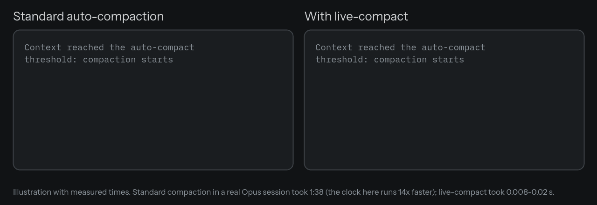
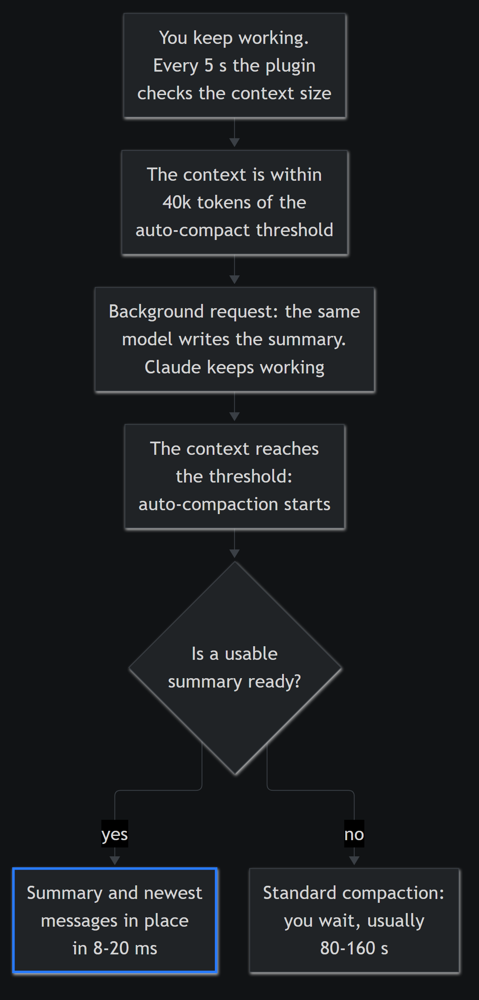

# live-compact

Auto-compaction for Claude Code without the wait.

When a long session reaches its context limit, Claude Code stops and has the model summarize the conversation. On long sessions this takes a minute or more, and you can do nothing while it runs. In our sessions on Opus it took 80-160 seconds, at worst over 4 minutes.

live-compact writes that summary in the background, while you keep working, as the context gets close to the limit. When auto-compaction starts, the plugin swaps in the ready summary in about 10-20 ms. It keeps the newest messages word for word. If no summary is ready yet, Claude Code compacts the usual way.



> [!IMPORTANT]
> live-compact uses Claude Code's plugin hook modules (`session.compact`, `$.model.fork`). That API is in early access and may change between releases. Tested on Windows: install and tests on Claude Code 2.1.300 to 2.1.317, compaction with the plugin on 2.1.317 from a clean profile. Other systems are not verified yet.

## How it works



Diagram source: [assets/how-it-works.mmd](assets/how-it-works.mmd).

1. Every 5 seconds the plugin reads the context size and Claude Code's auto-compact threshold.
2. When the context comes within 40k tokens of the threshold (at most 20% of the threshold), the plugin forks one background request. The fork uses the same model and the same transcript, and its only job is to write the summary. Your turn keeps running.
3. When auto-compaction starts (or you run `/compact` with no instructions), the plugin replaces the conversation with:
   - a first message with the summary, the path to the full transcript and the skills used earlier in the session,
   - every message after the point the fork saw, word for word, including messages you typed while Claude was working.
4. In every other case Claude Code compacts the usual way: no summary yet, the conversation was rewound past that point, a message with an image typed while Claude was working after that point, `/compact` with instructions, and subagents.

The summary prompt follows the structure of Claude Code's own summary. If your `CLAUDE.md` has a section on compaction (for example `# Compact instructions`), the summary follows it.

Skills invoked earlier carry over with the same limits as standard compaction: newest first, up to 5,000 tokens per skill and 25,000 tokens in total.

## Installation

```bash
claude plugin install live-compact --marketplace SocialBuzzStudio/live-compact
```

Or at the prompt of a session: `/plugin install live-compact --marketplace SocialBuzzStudio/live-compact`. Confirm adding the marketplace when asked. The one-line install needs Claude Code 2.1.292 or later; on older versions run `claude plugin marketplace add SocialBuzzStudio/live-compact`, then `claude plugin install live-compact@socialbuzzstudio`. Restart running sessions so the plugin loads in them. `claude plugin list` should show `live-compact@socialbuzzstudio` as `enabled`.

Auto-compaction must be on (the default). The plugin uses whatever threshold Claude Code uses, so `autoCompactWindow` in `settings.json` and `/autocompact` work as before.

## What you will see

After each compaction the plugin writes one line to the transcript. The model does not see it.

| Line | Meaning |
| --- | --- |
| `live-compact: compacted with the summary prepared in the background; N recent messages kept verbatim; skills carried over: S` | Compaction used the plugin's summary |
| `live-compact: no summary ready yet; standard compaction` | The summary was still being written, or the context never came close to the threshold (for example a manual `/compact` early on) |
| `live-compact: summary not used (<reason>); standard compaction` | The summary no longer fits the conversation: `anchor-missing` (the conversation was rewound), `too-long` (more than 4,096 messages), `image-sent-during-turn` (a message you typed while Claude was working has an image, which the plugin cannot keep) |
| `live-compact: background summary failed: <reason>` | The background request failed (`api-error <status>`, `empty-reply`, `nothing-to-fork`); it retries after another 20k tokens |

> [!NOTE]
> The first message after compaction shows up as a user message ("This session is being continued from a previous conversation..."). Plugins cannot mark a message as a compaction summary the way Claude Code does.

## Event log

Set `LIVE_COMPACT_LOG_DIR` to a folder to get one JSON line per event in `<session id>.jsonl`. Without it, the plugin writes nothing to disk. To log in every session, put it in `~/.claude/settings.json`:

```json
{ "env": { "LIVE_COMPACT_LOG_DIR": "/path/to/logs" } }
```

| `ev` | Fields |
| --- | --- |
| `fork-start` | `tokens` (context size), `threshold` |
| `fork-end` | `ms`, `chars` (summary length) or `reason` (failure), `stale` (a compaction came first), `usage`, `ctx` (input tokens) |
| `compact` | `trigger`, `prepared`, `own` (the plugin compacted), `kept` (messages kept verbatim), `of` (all messages), `tail` (tokens added after the fork started), `skills`, `skillsOmitted`, `skillCalls`, `sentDuringTurn` (messages typed while Claude was working, kept with the newest messages), `reason` |
| `tick-error` | `message` |

## Limitations

- One extra request per compaction. The fork reads the whole transcript, mostly from the prompt cache, about what a standard compaction reads. If you `/clear` or end the session before compaction, that request is wasted.
- A step that adds more than about 40k tokens at once (for example several large files read in parallel) can cross the threshold before the summary is ready. That compaction is a standard one.
- A larger context after compaction. Messages after the fork's starting point stay word for word, usually up to about 40k tokens.
- Images in the kept messages are dropped. Text from tool results stays.
- The ready summary is dropped after `/clear`, resuming or forking the session, and reloading the plugin. The next compaction may then be a standard one.
- Subagents compact the usual way.
- Classic `PreCompact` and `PostCompact` hooks may not run when the plugin handles compaction.
- Not yet verified:
  - Deferred tools loaded with `ToolSearch` before compaction may need to be searched for again.
  - After you resume a session, a later standard compaction may not carry the full skill texts from the plugin's first message.

## Disable or remove

```bash
claude plugin disable live-compact@socialbuzzstudio    # back to standard compaction
claude plugin uninstall live-compact@socialbuzzstudio
claude plugin marketplace remove socialbuzzstudio
```

Running sessions pick up the change after `/reload-plugins` or a restart.

## Development

```bash
claude plugin test mod        # tests, no model calls
claude plugin validate mod
claude --plugin-dir ./mod     # a session with the plugin loaded from disk
```

| Path | What |
| --- | --- |
| [mod/hooks/register.ts](mod/hooks/register.ts) | Hooks, timer, background fork, event log |
| [mod/hooks/compaction.ts](mod/hooks/compaction.ts) | The point the fork saw and the messages kept after compaction |
| [mod/hooks/skills.ts](mod/hooks/skills.ts) | Skills found in the conversation and their section in the first message |
| [mod/hooks/summary-prompt.ts](mod/hooks/summary-prompt.ts) | The summary prompt and the first message |
| [mod/tests/](mod/tests/) | Tests |
| [.claude-plugin/marketplace.json](.claude-plugin/marketplace.json) | The `socialbuzzstudio` marketplace |
